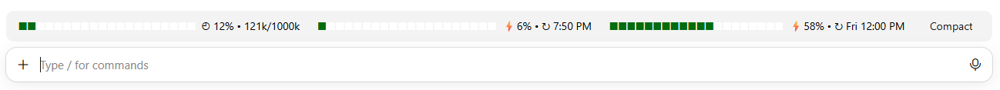

# usage-meter — context & quota bars for Claude Code

**English** | [Tiếng Việt](README.vi.md)

A Claude Code mod (plugin) that draws three slim, live progress bars **right above the chat box**, plus a **Compact** button:



(Green blocks = used, white blocks = left.)

| Bar | Meaning |
|---|---|
| `◴ 12% • 121k/1000k` | **Context window**: percent used, tokens in use / the model's context window |
| `⚡6% • ↻ 7:50 PM` | **5-hour quota**: percent used and when it resets (local time) |
| `⚡58% • ↻ Fri 12:00 PM` | **Weekly quota**: percent used, reset day and time (local time) |
| **Compact** | Runs `/compact`, just like typing it |

- Each bar has 20 blocks (5% each). When the window narrows, the blocks shrink evenly and the labels never wrap.
- **Live**: updates after every model response (even mid-turn), after every turn, when a quota moves a point, and right after a compaction.
- The **Compact** button works once Claude has finished answering.
- Works in the terminal and in the desktop app (Code tab).

## Install

In a Claude Code session in the terminal:

```
/plugin install usage-meter --marketplace teontdev/claude-code-usage-meter
```

Or from a shell:

```bash
claude plugin install usage-meter --marketplace teontdev/claude-code-usage-meter
```

In the desktop app (where `/plugin` doesn't run): click **+** next to the chat box → **Plugins** → **Add marketplace**, enter `teontdev/claude-code-usage-meter` → **Add plugin**.

When asked `Add marketplace?`, answer `y`, then pick the install scope.

## Notes

- **5-hour / weekly quota** bars need a Claude subscription plan. Before the first response (or with an API key) they show `--`.
- Quota figures come with each API response, so they don't change between responses.
- Reset times are shown in your machine's time zone.
- Right after a compaction the context bar shows the compaction's own token count; the exact figure follows with the next response.
- The mod uses Claude Code's mod API (early access, may change between releases). Written and tested on Claude Code 2.1.317.
- On desktop the mod draws in the band above the chat box (`AbovePrompt`); it can't sit beside the model picker yet.

## Development

```bash
claude plugin validate .
claude plugin test .
```

Try it from the source folder without installing:

```bash
claude --plugin-dir .
```

Main source: [`hooks/register.tsx`](hooks/register.tsx). Tests: [`tests/bars.test.tsx`](tests/bars.test.tsx).

## License

[MIT](LICENSE)
