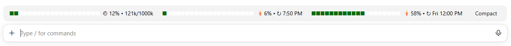

# usage-meter — thanh context & quota cho Claude Code

[English](README.md) | **Tiếng Việt**

Một "mod" (plugin) cho Claude Code hiển thị ngay **phía trên ô chat** ba thanh tiến độ nhỏ, cập nhật liên tục, kèm nút **Compact**:



(Khối xanh lá = đã dùng, khối trắng = còn lại.)

| Thanh | Ý nghĩa |
|---|---|
| `◴ 12% • 121k/1000k` | **Context window**: % đã dùng, số token đang dùng / kích thước cửa sổ context của model |
| `⚡6% • ↻ 7:50 PM` | **Quota 5 giờ**: % đã dùng và giờ reset (theo giờ máy) |
| `⚡58% • ↻ Fri 12:00 PM` | **Quota tuần**: % đã dùng, thứ và giờ reset (theo giờ máy) |
| **Compact** | Chạy `/compact`, như gõ tay |

- Mỗi thanh gồm 20 khối (mỗi khối = 5%). Khi thu nhỏ cửa sổ, các khối co lại đều nhau, chữ không bị xuống dòng.
- **Realtime**: cập nhật sau mỗi response của model (kể cả giữa một turn), sau mỗi turn, khi quota nhích 1%, và ngay sau khi compact.
- Nút **Compact** bấm được khi Claude đã trả lời xong.
- Chạy được ở cả terminal và app desktop (tab Code).

## Cài đặt

Trong một phiên Claude Code ở terminal:

```
/plugin install usage-meter --marketplace teontdev/claude-code-usage-meter
```

Hoặc từ shell:

```bash
claude plugin install usage-meter --marketplace teontdev/claude-code-usage-meter
```

Trong app desktop (nơi `/plugin` không chạy): bấm **+** cạnh ô chat → **Plugins** → **Add marketplace**, nhập `teontdev/claude-code-usage-meter` → **Add plugin**.

Khi được hỏi `Add marketplace?` chọn `y`, rồi chọn phạm vi (scope) cài đặt.

## Lưu ý

- **Quota 5h / tuần** chỉ có khi dùng Claude theo gói subscription; trước response đầu tiên (hoặc khi dùng API key) hiện `--`.
- Thông tin quota do API báo về trong mỗi response, nên giữa hai response số không đổi.
- Giờ reset hiển thị theo múi giờ của máy bạn.
- Ngay sau khi compact, thanh context hiện số token do lần compact báo về; số chính xác có ở response kế tiếp.
- Mod dùng API mod của Claude Code (đang ở giai đoạn early access, có thể đổi giữa các bản). Viết và kiểm tra trên Claude Code 2.1.317.
- Trên desktop, mod vẽ ở dải phía trên ô chat (`AbovePrompt`); chưa đặt được cạnh ô chọn model.

## Phát triển

```bash
claude plugin validate .
claude plugin test .
```

Chạy thử từ thư mục mã nguồn mà không cần cài:

```bash
claude --plugin-dir .
```

Mã nguồn chính: [`hooks/register.tsx`](hooks/register.tsx). Test: [`tests/bars.test.tsx`](tests/bars.test.tsx).

## Giấy phép

[MIT](LICENSE)
